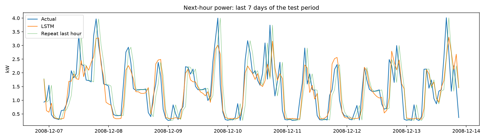

# Household Power Consumption Forecasting (LSTM)

Predicts the average household power (kW) for the **next hour** from the previous 24 hours of readings.

## Data
UCI "Individual household electric power consumption" dataset (not included, 49 MB).
The file used here has 1,048,575 minute-level rows (2006-12-16 to 2008-12-13), resampled to hourly averages.
Split by time: 70% train, 15% validation, 15% test (2008-08-26 onward).

## Model
Stacked LSTM (64 -> 32 units) with dropout. Inputs: 7 measurements + hour of day and day of week.
Scaling is fitted on the training period only.

## Results (test period, never seen in training)
| Method | MAE (kW) | RMSE (kW) |
|---|---|---|
| LSTM | FILL IN | FILL IN |
| Repeat last hour | FILL IN | FILL IN |
| Same hour yesterday | FILL IN | FILL IN |



## Run
```
pip install -r requirements.txt
python train_power.py        # needs household_power_consumption.csv in the folder
python predict.py            # interactive
python predict.py --at "2008-12-12 08:00"
python predict.py --csv sample_input.csv
```